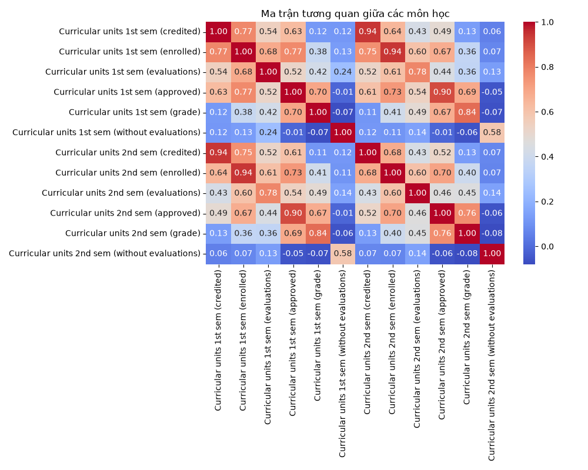
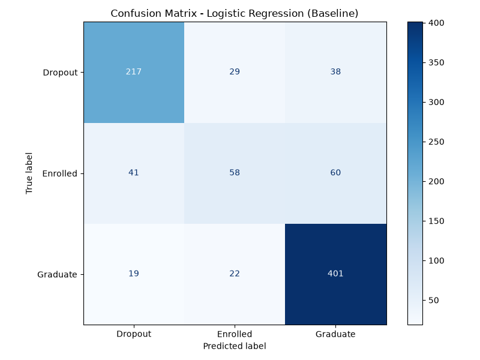
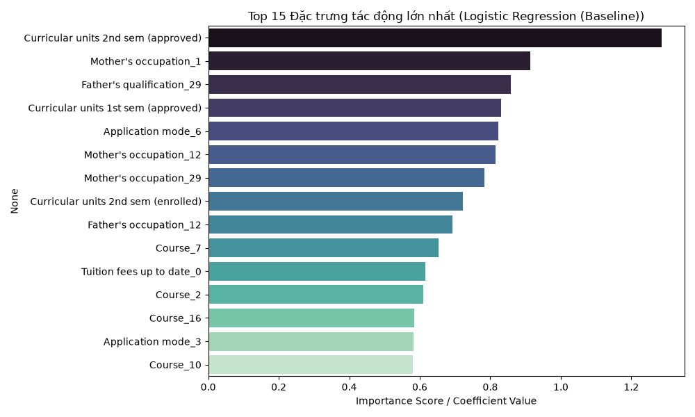
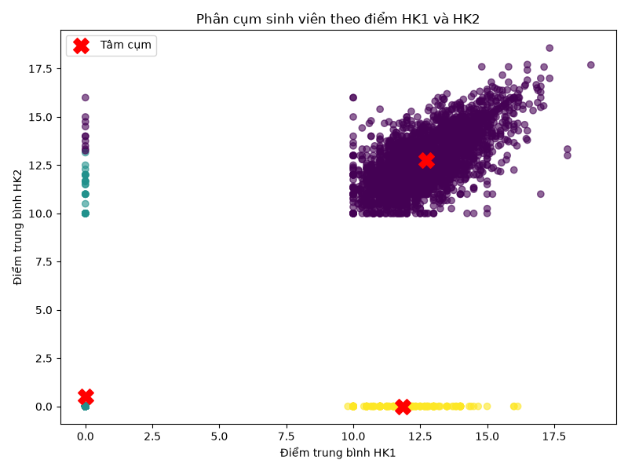

# BÁO CÁO ĐỒ ÁN MÔN HỌC: NHẬP MÔN PHÂN TÍCH DỮ LIỆU VÀ AI
**Đề tài:** Dự đoán Nguy cơ Bỏ học và Kết quả Học tập của Sinh viên (Predict Students' Dropout and Academic Success)

---

## 1. Bài toán, Bối cảnh và Mô hình Baseline
- **Bối cảnh:** Cảnh báo sớm nguy cơ sinh viên bỏ học giúp Phòng Công tác Sinh viên và Ban Đào tạo đưa ra giải pháp hỗ trợ kịp thời.
- **Phân loại bài toán:** Phân loại đa lớp (Multi-class Classification) với 3 nhãn: `Dropout` (Bỏ học), `Enrolled` (Đang học), `Graduate` (Tốt nghiệp).
- **Mô hình Baseline:** Logistic Regression với các thuộc tính được chuẩn hóa làm cơ sở so sánh.

---

## 2. Nguồn Dữ liệu và Phân tích Khám phá (EDA)
- **Bộ dữ liệu:** *Predict Students' Dropout and Academic Success* từ UCI / Kaggle (4,424 bản ghi, 35 thuộc tính).
- **Chất lượng dữ liệu:** Không có giá trị thiếu (0 NA).
- **Trực quan tương quan:** Điểm số học kỳ 2 (`Curricular units 2nd sem grade`) có tương quan thuận mạnh nhất với khả năng hoàn thành chương trình học.

---

## 3. Quy trình Xây dựng Pipeline và Chống Data Leakage
- **Phân tách tập dữ liệu:** Chia 80% Train và 20% Test, sử dụng `stratify` để giữ nguyên tỉ lệ nhãn.
- **Xử lý đặc trưng:**
  - Biến định lượng: Chuẩn hóa bằng `StandardScaler`.
  - Biến định tính: Mã hóa bằng `OneHotEncoder(handle_unknown='ignore')`.
- **Chống rò rỉ dữ liệu (Data Leakage):** Đóng gói toàn bộ các bước biến đổi dữ liệu và mô hình vào `scikit-learn Pipeline`. Việc `fit` biến đổi chỉ diễn ra trên tập Train.

---

## 4. Kết quả So sánh và Đánh giá Mô hình
Đánh giá qua Cross-Validation 5-fold trên tập Train và kiểm thử độc lập trên tập Test:

| Mô hình | Cross-Validation Accuracy | Test Accuracy |
|---|---:|---:|
| **Logistic Regression (Baseline)** | **76.80%** | **77.18%** |
| Decision Tree | 75.65% | 76.05% |
| Random Forest | 78.35% | 78.98% |

### Ma trận nhầm lẫn (Confusion Matrix):
Mô hình phân loại tốt nhóm `Graduate` và `Dropout`, tuy nhiên nhóm `Enrolled` hay bị nhầm lẫn do đặc trưng điểm số nằm ở ranh giới trung gian.

---

## 5. Diễn giải Kết quả, Rủi ro và Giới hạn
### Các đặc trưng ảnh hưởng lớn nhất:
1. `Curricular units 2nd sem (approved)`: Số tín chỉ đạt ở HK2.
2. `Tuition fees up to date`: Tình trạng đóng học phí đúng hạn.
3. `Curricular units 1st sem (approved)`: Số tín chỉ đạt ở HK1.

### Rủi ro & Khuyến nghị:
- Dự báo từ mô hình chỉ đóng vai trò **cảnh báo sớm** để giáo viên chủ nhiệm gặp gỡ, tư vấn.
- Không dùng kết quả dự báo làm căn cứ tự động xét duyệt học bổng hay đình chỉ học tập của sinh viên.

---

## 6. Mở rộng Ứng dụng AI: Gom cụm Sinh viên (K-Means)
Phân sinh viên thành 3 nhóm năng lực học tập dựa trên điểm trung bình HK1 và HK2 để xây dựng chính sách hỗ trợ phù hợp.

---

## 7. Bàn giao Dự án
- **Mã nguồn đầy đủ:** Luôn sẵn sàng tái lập môi trường qua `requirements.txt`.
- **Cấu trúc lưu trữ:** Chuẩn hóa, không lưu các tệp rác hay môi trường tạm lên Git.